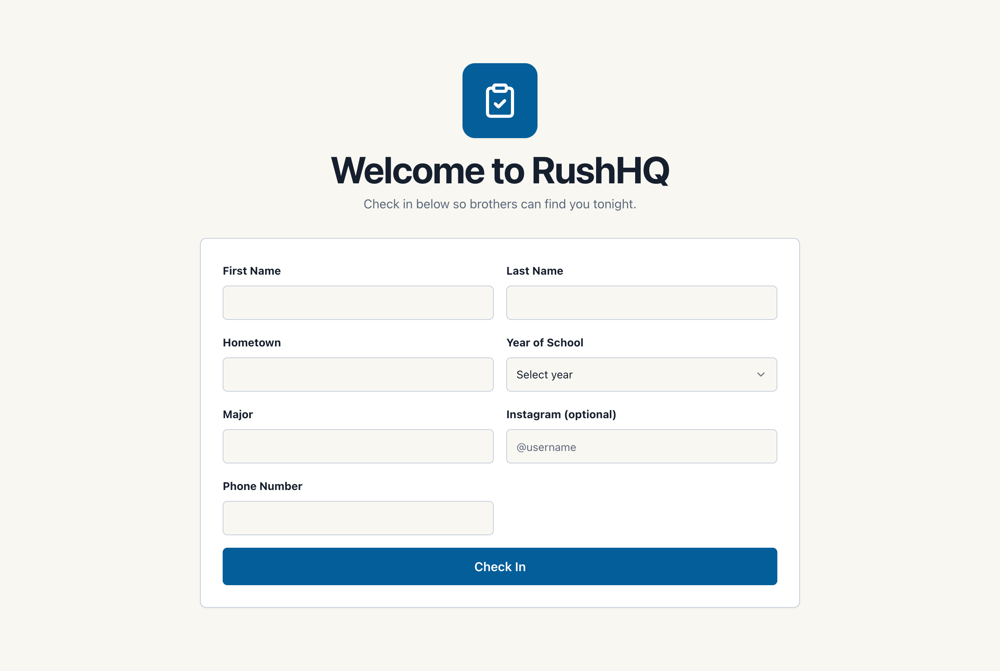
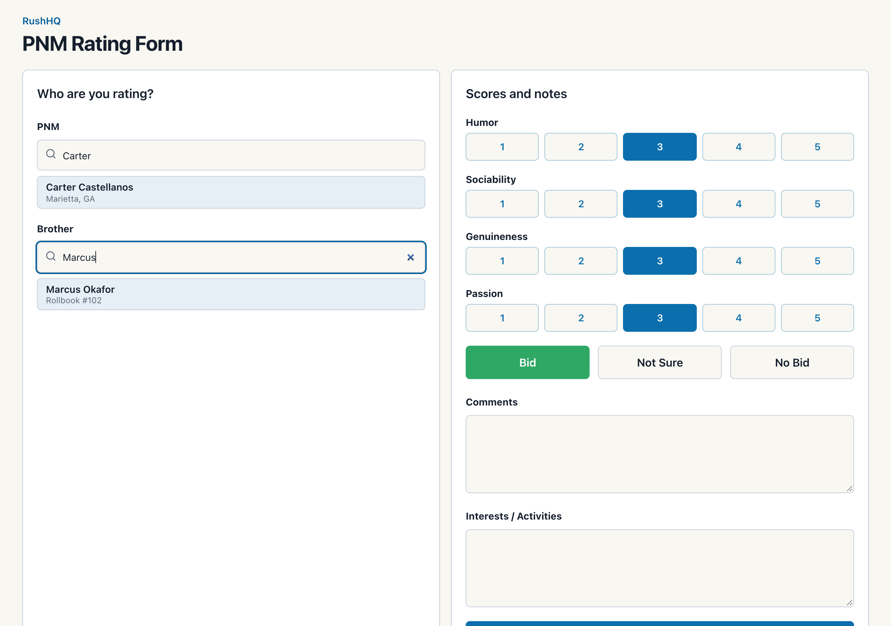
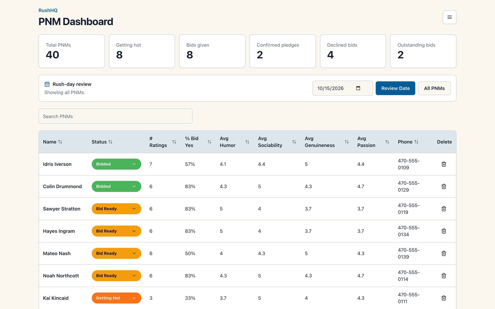
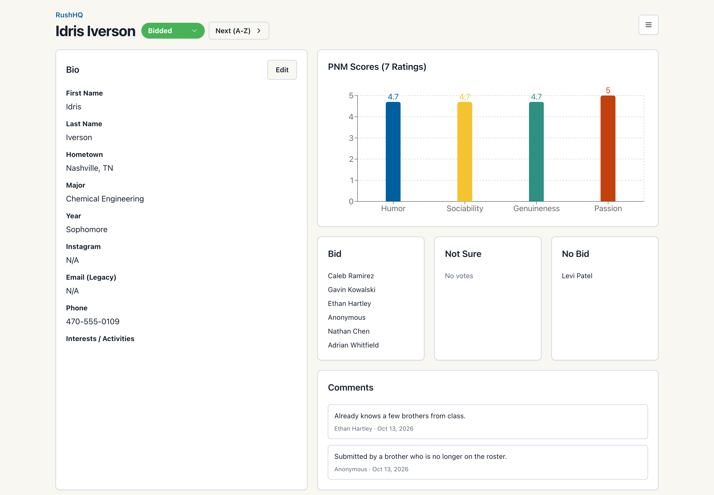
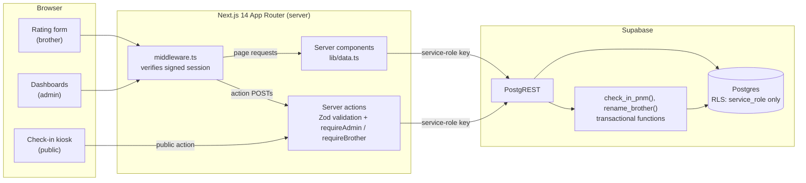
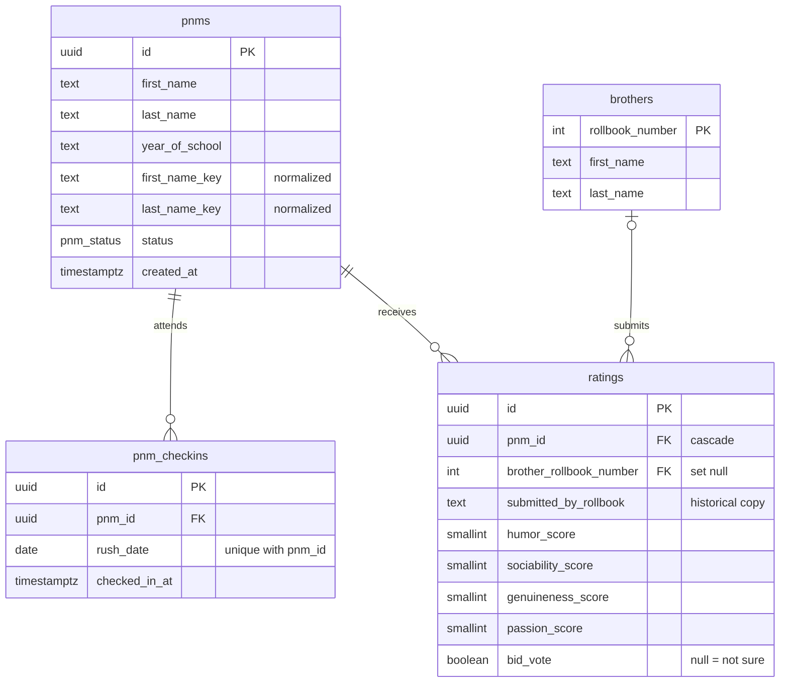

# RushHQ

A full-stack recruitment platform for fraternity rush: PNMs check in at the door, brothers rate them from their phones, and recruitment admins review everything afterward to make bid decisions.

I built RushHQ for my fraternity chapter at Georgia Tech. A 99-member chapter used it during rush in place of the legacy recruitment software it had relied on before. This repository is a cleaned-up, self-contained version of that deployment (see [Project history](#project-history)).

Engineering highlights:

- **Check-in that cannot duplicate a person under concurrent submissions.** One Postgres function takes an advisory lock per normalized identity, then finds or creates the PNM ([migration](supabase/migrations/20261015121000_check_in_pnm_optional_args.sql), [pgTAP](supabase/tests/database/check_in_pnm.test.sql), [25-way concurrency test](tests/integration/check-in-concurrency.test.ts)).
- **Signed, expiring sessions replacing a forgeable cookie.** The original cookie just said "admin" ([lib/session.ts](lib/session.ts), [tests](tests/unit/session.test.ts)).
- **Database grants that actually hold.** Supabase's default privileges had left the check-in function callable with the public anon key; now only `service_role` can execute it, and RLS tests confirm anon sees nothing ([rls.test.sql](supabase/tests/database/rls.test.sql)).
- **Reads that survive PostgREST's 1000-row cap.** A silent truncation that would have skewed every dashboard past 1000 ratings, now paged and covered by an [integration test with 1,100 extra rows](tests/integration/large-tables.test.ts).
- **Time zone and DST-pinned tests** for the 6am-Eastern "rush day" rule, run in `Asia/Tokyo` so they cannot pass by accident ([rush-day.test.ts](tests/unit/rush-day.test.ts)). Brother renumbering is a single transaction too ([rename_brother.test.sql](supabase/tests/database/rename_brother.test.sql)).


[](https://github.com/icampbell47/rushhq/actions/workflows/ci.yml)

| Check-in kiosk | Rating form |
| --- | --- |
|  |  |
| **PNM dashboard** | **PNM overview** |
|  |  |

<sub>Screenshots are from a local instance running the fictional seed data in `supabase/seed.sql`.</sub>

## What it does

RushHQ has three access tiers, matching the three phases of a rush event.

- **Public check-in.** A kiosk form on a shared tablet. PNMs enter their name, hometown, year, major, phone, and optionally Instagram. Repeat visitors are matched to their existing record (by normalized name and school year) instead of being duplicated, and each rush day they attend is recorded.
- **Brother ratings.** Password-protected and phone-first. A brother searches for a PNM and for himself, scores four categories from 1 to 5, votes bid / not sure / no bid, and leaves optional notes. The form remembers the brother on that device and warns if he already rated the selected PNM.
- **Admin review.** A sortable dashboard with summary counts, inline optimistic status changes, and a rush-day filter; a per-PNM page with a score chart, vote breakdown, comments, editable bio, and a "Next (A-Z)" button for stepping through one night's PNMs in a meeting; and a brother roster with participation stats.

## Architecture



The browser never talks to Supabase. Middleware gates the brother and admin routes (including server-action POSTs to them); the kiosk's check-in action on `/` is public by design. Every read happens in a server component and every write in a server action, both using the service-role key, which is guarded by `import "server-only"` so it cannot be bundled into client code. Row level security is enabled on every table with policies that admit only `service_role`, so the public anon key reads and writes nothing (`supabase/tests/database/rls.test.sql` checks this).



## Key engineering decisions

**Duplicate-proof check-in under concurrency.** Several tablets submit check-ins at once, and the same person may type their name differently on different nights. Check-in is a single Postgres function, `check_in_pnm`, that takes a transaction-scoped advisory lock on the normalized identity (year + first + last name keys), then finds or creates the PNM and inserts a check-in with `ON CONFLICT (pnm_id, rush_date) DO NOTHING`. Two submissions for the same person serialize on the lock; different people never block each other.

Why a lock rather than a unique index on the identity keys with `ON CONFLICT`: that index is the more conventional design, but it can only be built once existing rows have non-null keys and no duplicates. The keys were added to a production table that already had data (backfilled in `20260820133000_production_hardening.sql`), and any duplicates created before then would make the index fail to build. The lock gives new check-ins the same guarantee without that cleanup. Merging any old duplicates and then adding the unique index is the natural next step. The integration test fires 25 simultaneous spelling variants at the local API and expects one PNM and one check-in. As a sanity check, I removed the lock (and added a 50 ms sleep to widen the race window); the same test then produced 9 to 10 duplicate PNMs in each of three local runs.

**One normalization rule, implemented twice and tested against itself.** Identity keys lowercase, strip accents (NFKD), and drop everything but `[a-z0-9]`, so "Jean-Luc O'Neil" and "jean luc oneil" match. The app computes keys in TypeScript (`lib/pnm-identity.ts`), and SQL needs the same rule for backfills. The two had drifted on accented names; a migration aligned them, and the Vitest and pgTAP suites now assert the same cases.

**Atomic rollbook renumbering.** Ratings reference brothers by rollbook number, and the foreign key does not cascade updates. Changing a brother's number used to take three separate requests (insert the new row, repoint ratings, delete the old row), so a timeout in the middle left a duplicate brother or ratings split across two numbers. The `rename_brother` function does all three in one transaction, locks the source row, and fails cleanly if the target number is taken; `rename_brother.test.sql` checks that a failed rename changes nothing. Renames and same-number edits share one rule for contact fields: omitted keeps the stored value, an explicit blank clears it.

Both database functions are `SECURITY INVOKER` and executable only by `service_role`. That role already has the table privileges it needs and bypasses RLS, so running them with the owner's rights (`SECURITY DEFINER`, which `check_in_pnm` originally used) would add privilege for no reason.

**Rush days end at 6am Eastern.** Post-rush meetings run past midnight but belong to the previous night. `lib/rush-day.ts` assigns dates in `America/New_York` with a 6am cutoff, matching the column default in SQL. The tests cover the cutoff boundary, both 2026 DST transitions, and month/year rollback, and run with the process pinned to `Asia/Tokyo` so they cannot pass by accident on an East Coast machine.

**Signed shared-password sessions instead of user accounts.** Access is by tier, not by person. The check-in kiosk on a shared tablet needs no login at all; brothers sign in once on their own phones with the brother password and stay signed in for the season; recruitment admins share an admin password. Each tier has a shared password, compared in constant time, and a successful login sets an HS256 JWT (via `jose`, so the same code runs in Edge middleware) carrying the tier, issuer, and expiry: 30 days for brothers, 12 hours for admins. Middleware verifies it for routing, and every page and server action re-checks it with `await requireAdmin()` / `await requireBrother()`, since server actions can be called directly. A missing `await` on those checks would be a silent bypass, so ESLint's `no-floating-promises` rule is an error.

Tradeoff: there is no per-person audit trail, and rotating a password signs nobody out until their token expires (rotate `SESSION_SECRET` to revoke all sessions). Supabase Auth would solve both, but it would mean creating and supporting an account for every member of the chapter for a tool used mainly during rush, when the permission model only has two levels.

**Least data to the client.** The public check-in action returns only success or a generic error, never the stored record, since a repeat check-in matches an existing PNM by name and would otherwise let anyone look one up. The rating page is reachable by every brother, so it receives only picker fields (no PNM phone numbers, emails, or other brothers' comments). Admin pages are the only place contact details are rendered.

**No silent truncation.** PostgREST returns at most 1000 rows per request (including embedded rows) without reporting an error. Every list read goes through `selectAll` (`lib/supabase/select-all.ts`), which pages with an exact count and a stable order.

**Optimistic status updates.** Admins change many statuses in a row during review. The status dropdown updates local state immediately, persists through a server action, and rolls back with an error toast on failure, instead of refetching the whole dashboard.

**Bounded server actions.** Every Supabase call from a server action has a 15-second abort signal, and actions return a typed `{ ok, data } | { ok, error }` result instead of throwing, so a stalled request on venue Wi-Fi shows a retryable error instead of an endless spinner.

**Generated types.** `lib/types/supabase.ts` is unmodified `supabase gen types` output, and CI fails if it drifts from the migrations. Regenerating it exposed a real bug: `submitted_by_rollbook` is `TEXT`, so the duplicate-rating warning had been comparing a string to a number.

## Running locally

Requirements: Node 22 (`.nvmrc`), Docker, and the [Supabase CLI](https://supabase.com/docs/guides/cli).

```bash
npm ci
npm run db:start            # starts local Supabase, applies migrations, loads seed.sql
cp .env.example .env.local  # then fill it in, see below
npm run dev                 # http://localhost:3000
```

In `.env.local`, set `SUPABASE_URL` and `SUPABASE_SERVICE_ROLE_KEY` to the `API_URL` and `SERVICE_ROLE_KEY` values from `supabase status -o env` (the API URL is `http://127.0.0.1:54321`). Pick any `BROTHER_PASSWORD` and `ADMIN_PASSWORD`, and generate `SESSION_SECRET` with `openssl rand -base64 48`.

Then open `/` for the check-in kiosk, `/rate` for the brother form, and `/pnms` or `/brothers` for the admin dashboards. The seed contains 15 brothers, 40 PNMs across the three most recent rush days, and 165 ratings, all fictional.

| Script | What it does |
| --- | --- |
| `npm run db:reset` | Rebuild the local database from migrations and seed |
| `npm run db:types` | Regenerate `lib/types/supabase.ts` from the local schema |
| `npm run db:stop` | Stop the local Supabase containers |

## Testing

| Command | Covers | Needs |
| --- | --- | --- |
| `npm test` | Vitest unit tests: identity normalization, rush-day boundaries, Zod schemas, session tokens (tampering, wrong secret, expiry, `alg: none`), redirect safety, dashboard aggregations, pagination, what the public check-in action returns | nothing |
| `npm run test:db` | pgTAP: `check_in_pnm` and `rename_brother` behavior and privileges, RLS for `anon` / `authenticated` / `service_role`, schema invariants | local Supabase |
| `SUPABASE_INTEGRATION=1 npm run test:integration` | Concurrency stress test against the local REST API, and the data layer on tables past the 1000-row cap | local Supabase |
| `npm run lint` / `npm run typecheck` | ESLint (including `no-floating-promises`) and `tsc --noEmit` | nothing |

The concurrency test is a stress test, not a proof: a pass means the race was not observed in that run. The correctness argument is the advisory lock; the test is there to catch a regression that removes it.

`.github/workflows/ci.yml` runs all of the above on every push: lint, typecheck, unit tests, and a production build without secrets in one job, and in another a fresh local Supabase stack (which replays every migration and the seed), the pgTAP suite, a generated-types drift check, and the integration tests.

## Project structure

```
app/                  routes (App Router) and server actions in app/actions/
components/           UI; components/ui/ holds the shadcn-style primitives
lib/
  auth.ts             tier checks and constant-time password comparison (server-only)
  session.ts          signed session tokens (Edge-safe)
  data.ts             server-side reads (server-only)
  aggregations.ts     pure dashboard math
  pnm-identity.ts     identity-key normalization
  rush-day.ts         6am-Eastern rush-date logic
  validations/        Zod schemas shared by forms and server actions
  types/supabase.ts   generated database types (do not edit)
supabase/
  migrations/         schema history
  seed.sql            fictional local data
  tests/database/     pgTAP suites
tests/
  unit/               Vitest
  integration/        tests that need a running Supabase
```

## Project history

The app was first built and deployed for my chapter's rush on a hosted Supabase project. This repository starts from a snapshot of that code (the first commit). The commits after it are cleanup and fixes I made to the snapshot before publishing it; each message explains what changed and why. They were tested against a local Supabase instance with fictional data and have not been deployed to the chapter's instance. The main differences from the deployed version:

- **Authentication.** The deployed version stored the tier name itself in the cookie, so it could be forged from devtools. Sessions are now signed and expiring, and the login redirect no longer accepts `/\host` style open redirects.
- **Database access.** The original grants left the `SECURITY DEFINER` check-in function executable by the public `anon` role through Supabase's default privileges. EXECUTE is now limited to `service_role`, and a pgTAP test pins it.
- **Replayable migrations.** A migration pulled from production could not be applied to a fresh database. It now replays from scratch, with a local seed and a test suite on top.
- **Data exposure.** The public check-in action no longer returns the matched PNM's record (phone, email, status) to anonymous callers, and the rating page no longer ships PNM contact details and other brothers' comments to every brother's browser.
- **Large tables.** Dashboard reads were single requests that PostgREST would have silently cut off at 1000 rows; they are now paginated.
- **Brother management.** Renumbering a brother is a single transaction instead of three requests, and adding a brother with a number that is already taken now fails instead of overwriting the existing brother.
- **Bugs found along the way.** Editing a PNM with no email or phone failed validation, one of the duplicate-rating warning's two comparisons could never match because of a string/number mismatch, and accented names could produce duplicate PNMs. Each is fixed in its own commit, with a unit or pgTAP test where the bug was behavioral.
- **Neutral branding.** Chapter-specific names, a hotlinked crest, and internal slang (a status called "Dumpster Toured" is now "Released") were removed. Set `NEXT_PUBLIC_CHAPTER_NAME` to brand a deployment.

The rename of `001_initial.sql` to a timestamped name means a database that recorded the old version would need `supabase migration repair` before new migrations are pushed. The new migrations are additive.

## Tradeoffs and next steps

- **No rate limiting.** Neither login nor the public check-in kiosk is throttled. The shared passwords are only as strong as their length, and anyone who finds the site can submit junk check-ins, which admins would have to delete. Proper throttling needs shared state (a table or Redis) because serverless instances do not share memory; until then, use long passwords and keep the kiosk URL off public pages.
- **Whole-table reads.** The dashboards page through every PNM and rating and aggregate in TypeScript, so payload grows with every rating. That keeps the math in one tested place and is fine at chapter scale (hundreds of PNMs, a few thousand ratings); well beyond that, per-PNM and per-brother summaries should move into SQL views.
- **Not-found status code.** Because the PNM route has a `loading.tsx` boundary, Next 14 streams a 200 before `notFound()` runs, so an unknown id renders the 404 page with a 200 status.
- **No browser end-to-end tests.** Flows are covered at the unit, database, and API layers; Playwright tests for check-in and rating would be the next addition.
- **Shared credentials.** Per-person accounts would give an audit trail of who changed a status, at the cost of onboarding every brother.
